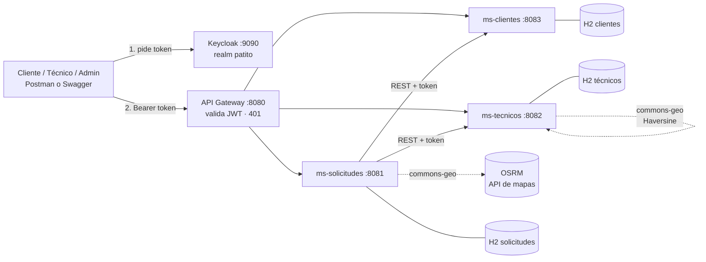
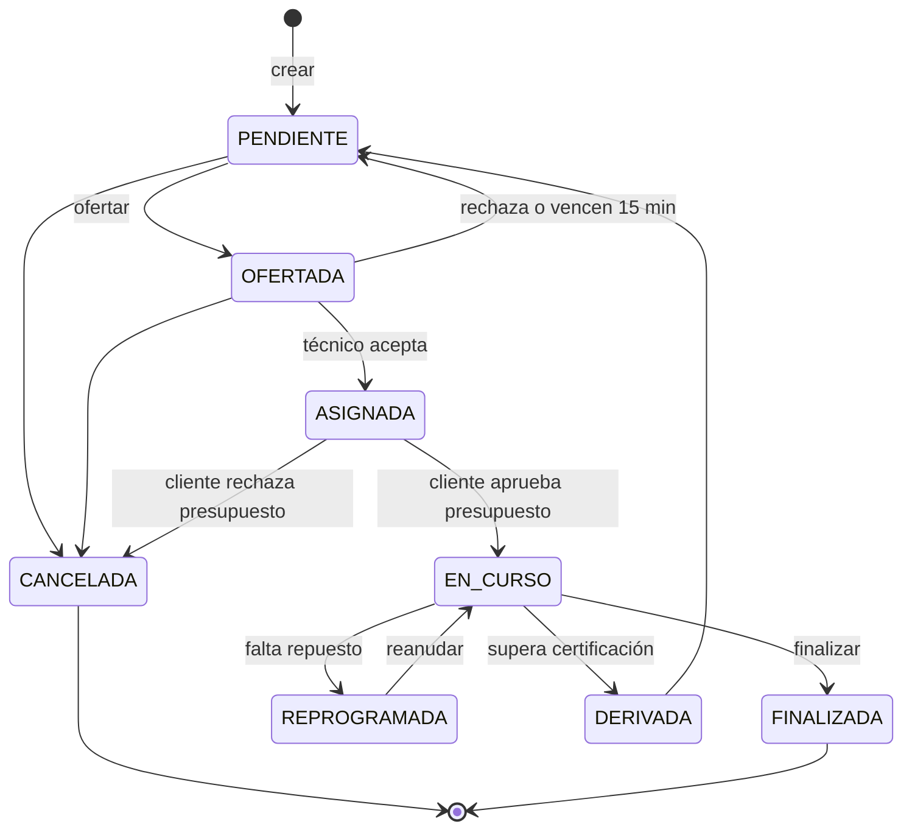

# TPI – Técnica Patito S.R.L.

Backend de Aplicaciones – UTN FRC – 3K1 – GRUPO-107

Backend de microservicios para una empresa de servicios técnicos domiciliarios de Córdoba. Gestiona el ciclo de vida completo de una solicitud: el cliente la crea, el sistema busca al técnico más cercano con la certificación necesaria, le envía una oferta con 15 minutos para aceptar, el técnico carga el presupuesto, el cliente lo aprueba y el trabajo se finaliza con el costo de visita calculado. Todo queda registrado en un historial de estados.

> ¿Primera vez? Leé la [guía paso a paso](docs/GUIA-PASO-A-PASO.md): explica cómo levantar todo y cómo usar Swagger y Postman, sin dar nada por sabido.

## Arquitectura



| Módulo | Puerto | Responsabilidad |
|---|---|---|
| `api-gateway` | 8080 | Único punto de entrada. Valida el JWT (401), rutea, genera el `X-Correlation-ID` y publica el Swagger unificado |
| `ms-solicitudes` | 8081 | Ciclo de vida de la solicitud, estados, ventana de 15 min, RN-5, costo de visita (Strategy) |
| `ms-tecnicos` | 8082 | Padrón de técnicos, certificaciones, zonas y búsqueda de candidatos (< 13 km) |
| `ms-clientes` | 8083 | Padrón de clientes con domicilio y coordenadas |
| `commons-geo` | — | Librería: Haversine + cliente OSRM con timeouts y respaldo |
| Keycloak | 9090 | Emite los tokens JWT (realm `patito`) |

Cada microservicio está organizado en `controllers`, `services`, `repositories`, `models`, `dtos`, `exceptions` y `config`.

**Seguridad en dos niveles:**
1. El **gateway** rechaza con **401** cualquier petición a `/api/**` sin un token válido.
2. Cada **microservicio** también valida el token y decide con `@PreAuthorize` si el rol puede hacer la operación. Si no puede, responde **403**.

## Cómo levantar todo

### Opción A: Docker (recomendada)

Requisitos: Java 21, Maven 3.9+, Docker con Compose. Los puertos 8080 a 8083 y 9090 tienen que estar libres.

```bash
# 1. Compilar y generar los JAR (los Dockerfile copian el JAR de target/)
mvn clean package -DskipTests

# 2. Construir las imágenes y levantar todo
docker compose up -d --build

# 3. Esperar a que todos estén "healthy" (tarda ~1 minuto)
docker compose ps
```

- **Desarrollo** (`docker compose up`): también aplica `docker-compose.override.yml` y publica los puertos de los microservicios (8081, 8082, 8083) para entrar a su Swagger y a la consola H2.
- **Producción** (`docker compose --file docker-compose.yml up -d --build`): solo publica el gateway (8080) y Keycloak (9090).

Para apagar: `docker compose down`. Para borrar también las bases y empezar de cero: `docker compose down -v`.

Variables opcionales: copiá `.env.example` como `.env`. La más útil es `OFERTA_VENTANA_MINUTOS=1`, para probar el vencimiento de ofertas (EN-07) sin esperar 15 minutos.

### Opción B: local, sin Docker para los microservicios

```bash
docker compose up -d keycloak          # solo Keycloak
mvn clean install -DskipTests
# una terminal por servicio, en este orden:
mvn -pl ms-clientes spring-boot:run
mvn -pl ms-tecnicos spring-boot:run
mvn -pl ms-solicitudes spring-boot:run
mvn -pl api-gateway spring-boot:run
```

No mezcles las dos opciones: usan los mismos puertos.

## Usuarios de prueba (Keycloak)

| Usuario | Contraseña | Rol |
|---|---|---|
| `admin1` | `admin123` | ADMINISTRADOR |
| `cliente1` | `cliente123` | CLIENTE |
| `tecnico1` | `tecnico123` | TECNICO |

Client: `bda-client` (público, con *Direct Access Grants* para Postman). Consola de Keycloak: http://localhost:9090 (usuario `admin` / `admin`).

## Documentación Swagger

| Qué | URL |
|---|---|
| Swagger unificado (los 3 servicios, a través del gateway) | http://localhost:8080/swagger-ui.html |
| MS-Solicitudes directo (solo en desarrollo) | http://localhost:8081/swagger-ui.html |
| MS-Técnicos directo | http://localhost:8082/swagger-ui.html |
| MS-Clientes directo | http://localhost:8083/swagger-ui.html |
| Consola H2 (ej. clientes) | http://localhost:8083/h2-console (JDBC URL `jdbc:h2:file:/app/data/clientes-db;AUTO_SERVER=TRUE`, usuario `sa`, sin clave) |

En Swagger, el botón **Authorize** pide el token: pegá el `access_token` de Keycloak, sin la palabra `Bearer`.

## Colección de Postman

Archivos en [`postman/`](postman/):
- `Tecnica-Patito.postman_collection.json`: la colección (67 peticiones con tests automáticos).
- `Tecnica-Patito.postman_environment.json`: el entorno "Técnica Patito – Local".

| Carpeta | Qué prueba |
|---|---|
| 00 – Seguridad | Obtiene los 3 tokens (correr siempre primero) |
| 01 – Clientes | Listar, consultar, registrar, modificar y eliminar clientes |
| 02 – Técnicos | Listar, consultar, candidatos (< 13 km), catálogos, registrar, disponibilidad |
| 03 – Solicitudes | Listado, estrategias de costo, patrón snapshot, rechazo de oferta |
| 04 – Flujo principal | EP-01 a EP-05: crear → elegir → ofertar → aceptar → presupuesto → aprobar → finalizar → historial |
| 05 – Escenarios negativos | EN-01 a EN-06, EN-08 y EN-10 |
| 06 – Escenarios manuales | EN-07 (oferta vencida) y EN-09 (servicio caído): necesitan una acción fuera de Postman |

Las carpetas 00 a 05 se pueden correr enteras con el *Runner*, todas las veces que quieras: los escenarios limpian lo que crean.

Por línea de comandos: `npx newman run postman/Tecnica-Patito.postman_collection.json -e postman/Tecnica-Patito.postman_environment.json --folder "00 – Seguridad" --folder "01 – Clientes" --folder "02 – Técnicos" --folder "03 – Solicitudes" --folder "04 – Flujo principal" --folder "05 – Escenarios negativos"`

## Endpoints

Todos a través de `http://localhost:8080`. Los roles son los que acepta `@PreAuthorize`.

### MS-Clientes
| Método | Endpoint | Operación | Roles |
|---|---|---|---|
| POST | `/api/v1/clientes` | Registrar un cliente | ADMINISTRADOR, CLIENTE |
| GET | `/api/v1/clientes?apellido=&page=&size=` | Listar clientes (paginado) | ADMINISTRADOR |
| GET | `/api/v1/clientes/{clienteId}` | Consultar un cliente con coordenadas | ADMINISTRADOR, CLIENTE |
| PUT | `/api/v1/clientes/{clienteId}` | Modificar un cliente | ADMINISTRADOR, CLIENTE |
| DELETE | `/api/v1/clientes/{clienteId}` | Eliminar un cliente | ADMINISTRADOR |

### MS-Técnicos
| Método | Endpoint | Operación | Roles |
|---|---|---|---|
| POST | `/api/v1/tecnicos` | Registrar técnico con certificaciones y zonas | ADMINISTRADOR |
| GET | `/api/v1/tecnicos?disponible=&page=&size=` | Listar técnicos (paginado) | todos |
| GET | `/api/v1/tecnicos/{tecnicoId}` | Perfil, disponibilidad y certificaciones | todos |
| GET | `/api/v1/tecnicos/candidatos?certificacionId=&latitud=&longitud=` | Disponibles, con la certificación y a < 13 km | todos |
| PATCH | `/api/v1/tecnicos/{tecnicoId}/disponibilidad` | Cambiar disponibilidad | ADMINISTRADOR, TECNICO |
| GET | `/api/v1/certificaciones` | Catálogo de certificaciones | todos |
| GET | `/api/v1/zonas` | Catálogo de zonas | todos |

### MS-Solicitudes
| Método | Endpoint | Operación | Roles |
|---|---|---|---|
| POST | `/api/v1/solicitudes` | Crear solicitud (PENDIENTE), copiando los datos del cliente | ADMINISTRADOR, CLIENTE |
| GET | `/api/v1/solicitudes?estado=&page=&size=` | Listar solicitudes (paginado) | todos |
| GET | `/api/v1/solicitudes/{solicitudId}` | Detalle y estado actual | todos |
| GET | `/api/v1/solicitudes/{solicitudId}/historial` | Historial de estados (RN-7) | todos |
| POST | `/api/v1/solicitudes/elegir` | Probar candidatos y costo antes de ofertar | ADMINISTRADOR, CLIENTE |
| POST | `/api/v1/solicitudes/{solicitudId}/ofertar/{tecnicoId}` | Enviar oferta → OFERTADA | ADMINISTRADOR, CLIENTE |
| POST | `/api/v1/solicitudes/{solicitudId}/aceptar/{tecnicoId}` | Aceptar oferta y calcular costo → ASIGNADA | ADMINISTRADOR, TECNICO |
| POST | `/api/v1/solicitudes/{solicitudId}/rechazar/{tecnicoId}` | Rechazar oferta → PENDIENTE | ADMINISTRADOR, TECNICO |
| POST | `/api/v1/solicitudes/{solicitudId}/presupuesto` | Cargar diagnóstico y presupuesto | ADMINISTRADOR, TECNICO |
| POST | `/api/v1/solicitudes/{solicitudId}/aprobar-presupuesto` | Aprobar presupuesto → EN_CURSO | ADMINISTRADOR, CLIENTE |
| POST | `/api/v1/solicitudes/{solicitudId}/cancelar?motivo=` | Cancelar (por ejemplo, presupuesto rechazado) | ADMINISTRADOR, CLIENTE |
| POST | `/api/v1/solicitudes/{solicitudId}/reprogramar?motivo=` | Falta de repuesto → REPROGRAMADA | ADMINISTRADOR, TECNICO |
| POST | `/api/v1/solicitudes/{solicitudId}/reanudar` | REPROGRAMADA → EN_CURSO | ADMINISTRADOR, TECNICO |
| POST | `/api/v1/solicitudes/{solicitudId}/derivar?motivo=` | EN_CURSO → DERIVADA → PENDIENTE | ADMINISTRADOR, TECNICO |
| POST | `/api/v1/solicitudes/{solicitudId}/finalizar` | Finalizar → FINALIZADA | ADMINISTRADOR, TECNICO |

## Estados de una solicitud



## Reglas de negocio implementadas

| Regla | Dónde | Cómo |
|---|---|---|
| RN-1 Tipos de servicio | `SolicitudRequest` | Bean Validation: marca, modelo, descripción y al menos un tipo. Si falta algo → 400 con el error de cada campo |
| RN-2 Candidatura | `TecnicoService.buscarCandidatos` | Disponible + certificación + radio. Sin candidatos → aviso `ALERTA ADMINISTRADOR` en el log |
| RN-3 Ventana de 15 min | `OfertaScheduler` + `SolicitudService.expirarOfertasVencidas` | `@Scheduled` + `@Transactional`; configurable con `OFERTA_VENTANA_MINUTOS` |
| RN-4 Un técnico por solicitud | `SolicitudService` + `@Version` | Solo el técnico ofertado responde; bloqueo optimista ante concurrencia |
| RN-5 Límite por técnico | `SolicitudService` | Máximo 2 en espera (OFERTADA/ASIGNADA/REPROGRAMADA) y 1 EN_CURSO → 422 |
| RN-6 Aprobación de presupuesto | `SolicitudService.aprobarPresupuesto` | Solo desde ASIGNADA y con presupuesto cargado → si no, 422 |
| RN-7 Estados e historial | `EstadoSolicitud` + `HistorialEstado` | Mapa de transiciones válidas; cada cambio guarda fecha, hora, usuario y observación |
| RN-8 Costo de visita | `CalculadoraCosto` + `commons-geo` | Monto fijo + km × tarifa; distancia real con OSRM y, si falla, Haversine |
| RN-9 Cercanía | `commons-geo` `Haversine` | Radio de 13 km (`app.candidatos.radio-km`) |
| RN-10 Snapshot *(definida por el equipo)* | `SolicitudService.crear/ofertar` | Se copian nombre, domicilio y coordenadas del cliente, y el nombre del técnico |
| RN-11 Estrategias de costo *(definida por el equipo)* | `services/costos` (patrón Strategy) | ESTANDAR, PRIORIDAD (+30 %), FUERA_HORARIO (+50 %, fines de semana, feriados, antes de las 8 o desde las 18) y COMBINADA |

Tarifas en `ms-solicitudes/src/main/resources/application.yml` (`tarifas.*`): monto fijo $5000 y $800 por km.

## Errores (ProblemDetail, RFC 7807)

| Código | Cuándo |
|---|---|
| 400 | Faltan datos o tienen formato inválido (incluye `errores` con el problema de cada campo) |
| 401 | Sin token o con un token inválido o vencido |
| 403 | El rol no tiene permiso |
| 404 | El recurso no existe |
| 422 | Se incumple una regla de negocio (DNI duplicado, transición inválida, RN-5, etc.) |
| 503 | Un microservicio del que se depende está caído (reintento + circuit breaker de Resilience4j) |

Todas las respuestas de error traen `correlationId`: buscándolo en los logs se sigue la petición por todos los servicios.

## Logs y monitoreo

- Logs a stdout con el formato `[nombre-servicio] [cid:<correlationId>]`. En Docker: `docker compose logs -f ms-solicitudes`.
- El gateway genera `X-Correlation-ID` si no viene en la petición, y cada servicio lo propaga en sus llamadas salientes.
- Actuator: `/actuator/health` es público; `info`, `metrics` y `loggers` requieren el rol ADMINISTRADOR. Ejemplo para cambiar un nivel de log en caliente: `POST /actuator/loggers/utnfc.isi.back.tpi` con `{"configuredLevel":"TRACE"}`.

## Decisiones del equipo

| Tema | Decisión | Motivo |
|---|---|---|
| Rutas | `/api/v1/...` | Lineamiento de la cátedra (versionado en la URI). El formulario del TPI decía `/api/...` |
| Base de datos | H2 **en archivo**, `ddl-auto: update`; en Docker, un volumen nombrado por servicio | Elección del equipo: los datos sobreviven a los reinicios. El DataLoader solo carga si la base está vacía |
| Versiones | Java 21, Spring Boot 3.5.0, Spring Cloud 2025.0.0, springdoc 2.8.9, Resilience4j 2.2.0 | Lineamientos de la cátedra (el formulario decía Java 25 y Boot 3.2.5) |
| Imagen base | `eclipse-temurin:21.0.8_9-jre` | Versión fija; las imágenes `openjdk` están discontinuadas |
| Domicilio | Calle y barrio como campos de `Cliente` | El DER solo tiene la entidad CLIENTE |
| Presupuesto | Nuevo `POST /{id}/presupuesto` | F7 pide que el técnico cargue el presupuesto y no había endpoint |
| Mapa | OSRM público con respaldo Haversine | Sin contenedor OSRM: requiere internet para la ruta real; sin internet, la distancia sale por Haversine |
| Zonas de cobertura | Informativas; la cobertura efectiva es el radio de 13 km | No hay geometría de zonas en el DER |
